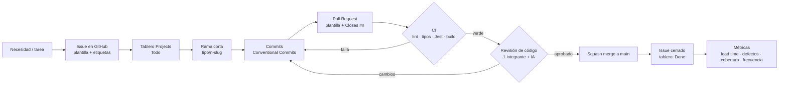
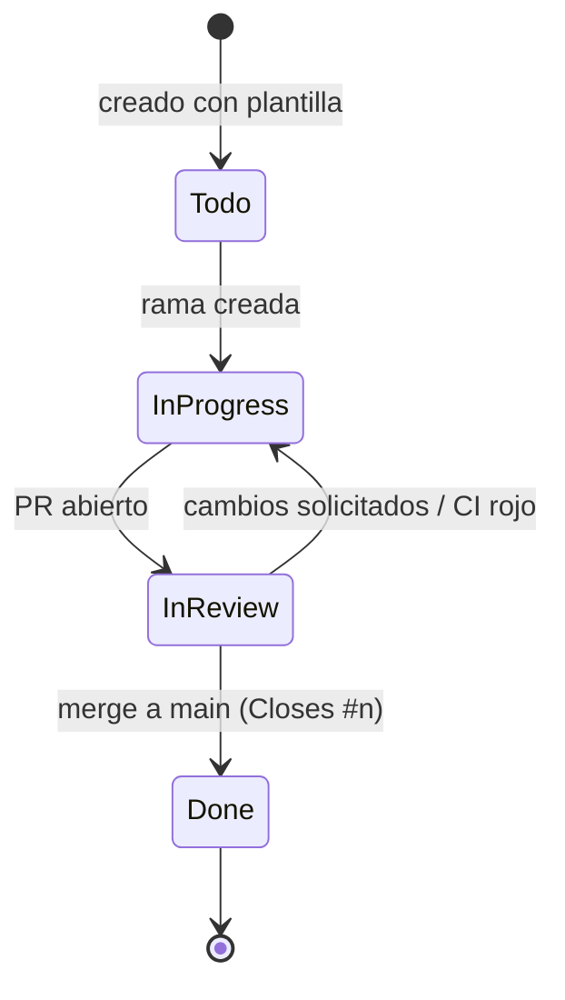

# Flujo del proceso de desarrollo

> Entregable 2 — sección (a). Issue del tablero: #13 "Issues, ramificación y estrategia de tests".
> Complementos: [Estrategia de pruebas](../06-testing/estrategia-tests.md) · [CI con GitHub Actions](../07-deployment-and-monitoring/ci-github-actions.md)

El equipo (3 integrantes) trabaja sobre un snapshot de Mattermost v11.11.1 en `app/`. La mejora (#17740, control de
animaciones de GIFs) es el vehículo; este documento describe **el proceso** que se aplica y se mide.

## 1. Vista general



## 2. Gestión de issues

**Regla:** ningún trabajo empieza sin issue. El issue es la unidad de planificación, de trazabilidad (rama → PR → commit)
y de medición (lead time).

| Elemento | Uso |
|---|---|
| **Tablero** | [GitHub Projects #2](https://github.com/users/amoramongeCenfo/projects/2). Estados: `Todo` → `In Progress` → `Done`. Un issue pasa a `In Progress` cuando se crea su rama. |
| **Plantillas** | `.github/ISSUE_TEMPLATE/`: `feature.yml` (funcionalidad, con criterios de aceptación y pruebas previstas), `bug.yml` (defecto, con origen de detección), `tarea.yml` (proceso/documentación, con definición de hecho). |
| **Responsable** | Un solo *assignee* por issue. Si dos personas colaboran, se divide en sub-issues. |
| **Etiquetas** | Se propone usar etiquetas por tipo (`enhancement`, `bug`, `documentation`, `accessibility`) y por área (`ci`, `tests`, `process`). |
| **Hitos** | Se propone un *milestone* por entrega (`Avance 2`, `Entrega final`, `Defensa`) para ver el avance por fecha. |
| **Tamaño** | Un issue debe poder cerrarse en ≤ 3 días de trabajo. Si no, se parte. |
| **Cierre** | Automático al hacer merge del PR que contiene `Closes #n`. Issues sin código (p. ej. PDF) se cierran a mano con enlace a la evidencia. |

### Ciclo de vida de un issue



## 3. Estrategia de ramificación

Se adopta **GitHub Flow** (variante liviana de *trunk-based development*):

- `main` es la única rama de larga vida y **siempre debe compilar y pasar CI**.
- Todo cambio entra por una rama corta creada desde `main` y vuelve por Pull Request.
- No hay ramas `develop` ni `release/*`.

### Convención de nombres

```
<tipo>/<n°-issue>-<slug-corto>
```

| Tipo | Uso | Ejemplo |
|---|---|---|
| `feature/` | Funcionalidad nueva | `feature/15-toggle-animaciones` |
| `fix/` | Corrección de defecto | `fix/42-gif-no-pausa-en-hilo` |
| `test/` | Solo pruebas | `test/26-cobertura-size-aware-image` |
| `ci/` | Pipeline / automatización | `ci/14-github-actions` |
| `docs/` | Documentación y proceso | `docs/13-flujo-desarrollo` |

### Reglas

1. Vida máxima de una rama: **3 días**. Si se alarga, se integra lo que esté listo detrás del ajuste por defecto
   (toggle desactivado no cambia comportamiento) o se divide el issue.
2. Antes de abrir el PR: `git fetch origin && git rebase origin/main` (historial lineal, conflictos se resuelven en la rama).
3. **Commits** con [Conventional Commits](https://www.conventionalcommits.org/es/v1.0.0/):
   `feat(display): agregar toggle de animaciones`, `test(images): ...`, `ci: ...`, `docs: ...`.
4. **Merge**: *squash merge* → un commit por issue en `main`, mensaje = título del PR + `(#PR)`.
5. Rama se borra al hacer merge.

### Protección de `main` (configuración en GitHub → Settings → Branches)

| Regla | Valor |
|---|---|
| Requerir Pull Request antes de merge | Sí |
| Aprobaciones requeridas | 1 (cualquier integrante distinto al autor) |
| *Status checks* requeridos | `lint`, `types`, `jest`, `build` (jobs del workflow *Webapp CI*) |
| Requerir rama actualizada con `main` | Sí |
| Permitir *force push* / borrado | No |

**Justificación.** Con 3 personas y entregas cada ~2 semanas, GitFlow agrega ramas y merges que no aportan: no hay
versiones paralelas que mantener. GitHub Flow reduce el *lead time* (métrica del proyecto), obliga a integrar seguido
(menos conflictos en componentes compartidos del webapp, riesgo identificado en E1) y deja toda la evidencia del proceso
en PRs revisables. **Limitación:** depende de que CI sea confiable y rápido; si el pipeline tarda demasiado, el equipo
tiende a saltarlo — por eso el CI ejecuta en PR solo las pruebas afectadas (ver CI).

## 4. Pull Requests y revisión de código

- Plantilla: `.github/pull_request_template.md` (resumen, `Closes #n`, cómo se probó, checklist, conteo de observaciones).
- **Revisor:** un integrante distinto al autor. Rotación sugerida: Edgar → Brandon → Alejandro → Edgar.
- **Revisión asistida por IA** (issue #17): antes de pedir revisión humana, el autor ejecuta una revisión con IA sobre el
  diff y registra herramienta + prompt en el anexo de IA. La IA no aprueba; solo el revisor humano.
- **Tiempo objetivo de respuesta:** 24 h hábiles.
- Cada observación del revisor queda como comentario en el PR → insumo de la métrica *defectos en revisión*.

## 5. Definición de hecho (DoD)

Un issue de funcionalidad está **hecho** cuando:

- [ ] Criterios de aceptación del issue cumplidos.
- [ ] Pruebas Jest nuevas/actualizadas para cada criterio (ver estrategia de pruebas).
- [ ] CI en verde.
- [ ] PR aprobado por 1 integrante e integrado a `main`.
- [ ] Textos nuevos de UI extraídos a i18n.
- [ ] Captura o GIF de la funcionalidad adjunta en el PR (evidencia para el entregable).

## 6. Trazabilidad y métricas

| Métrica | Fuente automática en este flujo |
|---|---|
| Lead time | Fecha de apertura del issue (o primer commit de la rama) → fecha de merge del PR. `gh pr list --state merged --json number,createdAt,mergedAt` |
| Defectos en revisión | Comentarios de revisión por PR + issues con plantilla `bug` y origen "Revisión de código". |
| Cobertura de pruebas | Resumen de cobertura del job `jest` en cada ejecución de CI (módulos afectados por #17740). |
| Frecuencia de cambios | PRs integrados por semana a `main`. |

## 7. Uso de IA en este documento

Borrador generado con Claude Code (Claude Opus 5.5) a partir de la consigna del E2, el informe del Avance 1 y el
tablero del proyecto; revisado y ajustado por el equipo. Prompt registrado en el anexo de IA del entregable.
