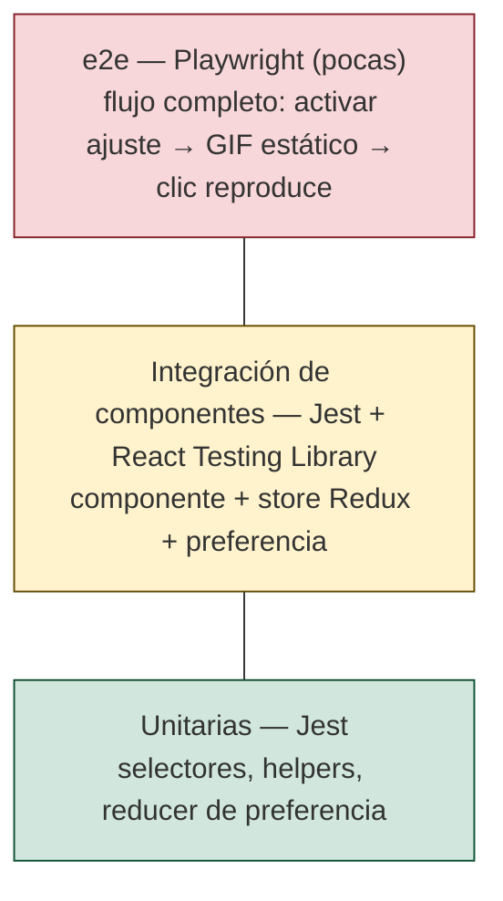

# Estrategia de pruebas

> Entregable 2 — sección (a). Issue del tablero: #13 "Issues, ramificación y estrategia de tests".
> Actualizado en la entrega final con el issue #26 (pruebas Jest/e2e y cobertura): matriz con el estado real, e2e C9 y línea base sin emojis. Después de #42: C6 y C8 cubiertos y cobertura medida otra vez.
> Relacionado: [Flujo de desarrollo](../04-development-process/flujo-desarrollo.md) · [CI](../07-deployment-and-monitoring/ci-github-actions.md)

## 1. Objetivo

Asegurar que el ajuste **«Animated images (GIFs)»** (#17740) funciona en todos los puntos donde
Mattermost renderiza GIFs, **sin romper el comportamiento actual** (ajuste activado por defecto), y producir
evidencia medible (cobertura, defectos) para el proceso.

## 2. Pirámide de pruebas



| Nivel | Herramienta | Qué cubre | Dónde viven | Cuándo corren |
|---|---|---|---|---|
| Unitarias | Jest | Selector de la preferencia (`get(state, category, name, default)`), helpers que deciden si animar, valor por defecto `true` | Junto al archivo: `foo.ts` → `foo.test.ts` (convención Mattermost) | Local + cada PR |
| Componentes | Jest + React Testing Library (`renderWithContext`) | Toggle en *Configuración > Pantalla*; `SizeAwareImage`, `SingleImageView`, `MarkdownImage`, vista ampliada: render estático vs. animado, clic/tap/Enter reproduce, botón de pausa | Co-ubicadas en `app/webapp/channels/src/components/...` | Local + cada PR |
| e2e | Playwright (`app/e2e-tests/playwright`, ya trae specs de `accessibility/`) | 3 escenarios de punta a punta sobre servidor real (C9), incluido uno en pantalla de teléfono | `app/e2e-tests/playwright/specs/functional/channels/animated_images/` | Manual antes de Code Freeze (#28) y para la demo |
| Manual / exploratoria | Mattermost local + checklist | Escritorio (hover) vs. móvil (tap), hilos, vista ampliada | Evidencia en el PR (captura/GIF) | Antes de pedir revisión |

**Por qué este reparto.** El 95 % del cambio es frontend React; Mattermost ya tiene una infraestructura Jest/RTL madura
(miles de pruebas, utilidades `renderWithContext`, mocks de store). Escribir ahí la mayoría de pruebas es barato, rápido y
corre en CI en minutos. Las e2e necesitan servidor + base de datos + navegador: son costosas de mantener en CI para un
equipo de 3, por eso se limitan a los escenarios de la demo y se corren manualmente.

## 3. Matriz criterio → prueba

| # | Criterio de aceptación (#17740) | Prueba | Nivel | Estado |
|---|---|---|---|---|
| C1 | Existe el toggle en Configuración > Pantalla, activado por defecto | `user_settings_display.test.tsx` (sección visible con su valor); `user_settings/display/index.test.ts` (sin preferencia guardada vale `true`, respeta `false`, modo admin) | Componente / unitaria | ✔ Cubierto |
| C2 | Cambiar el toggle guarda la preferencia del usuario (API de preferencias) | `user_settings_display.test.tsx` (mock de `savePreferences`); e2e C9 (recarga la página y la preferencia persiste) | Componente + e2e | ✔ Cubierto |
| C3 | Ajuste activado → GIF se reproduce igual que hoy (regresión) | `size_aware_image.test.tsx` (también sin preferencia guardada), `single_image_view.test.tsx`, `markdown_image.test.tsx` | Componente | ✔ Cubierto |
| C4 | Ajuste desactivado → GIF muestra primer cuadro (estático) | mismos archivos (adjunto, GIF por proxy/metadata, GIF en Markdown); una imagen no animada no cambia | Componente | ✔ Cubierto |
| C5 | Clic/tap sobre GIF estático lo reproduce; aparece botón de pausa | mismos archivos + `user-event`: clic, **tap táctil** (`pointer` con `TouchA`), **Enter** (teclado), pausa vuelve a estático, otro GIF empieza estático | Componente | ✔ Cubierto |
| C6 | Botón de pausa se oculta tras N s de inactividad | `animated_image_toggle.test.tsx` (visible al montar, se oculta a los 5 s, sigue en el DOM con nombre accesible, reaparece al cambiar play/pausa, limpia el timer); `size_aware_image.test.tsx` (centrado lejos de copiar/descargar, el cuadro sigue respondiendo al clic con el botón oculto) | Componente | ✔ Cubierto (implementado en #42: se oculta a los 5 s y reaparece con *hover* o foco de teclado) |
| C7 | ~~Emojis animados estáticos~~ — fuera de alcance (la mejora se limita a GIFs) | — | — | Fuera de alcance |
| C8 | Vista ampliada respeta estado pausado | `image_preview.test.tsx` (abre en pausa con el ajuste apagado, sigue animando con el ajuste encendido o sin valor, PNG no cambia, play/pausa con botón y con clic en el cuadro, zoom y desplazamiento sobre el cuadro, sin permiso de descarga) + paso en la e2e (escenario 2) | Componente + e2e | ✔ Cubierto (implementado en #42; los hilos de #24 quedan fuera) |
| C9 | Flujo completo usuario: desactivar → ver canal con GIF → estático → clic → anima | `specs/functional/channels/animated_images/animated_images_setting.spec.ts` (3 escenarios: flujo completo + persistencia, clic sobre GIF en reproducción abre la vista ampliada **y esta lo abre en pausa (C8)**, pantalla de teléfono 390×844) | e2e | ✔ Escrita; se corre manualmente con servidor local (setup opción B) |

**Verificación de las pruebas (regla 5).** Se hizo prueba de mutación manual: con el valor por defecto cambiado a
`false` y con el componente ignorando la preferencia, fallan 12 pruebas nuevas; las que siguen pasando son los casos
de regresión con el ajuste activado, que deben pasar igual.

**Efecto en pruebas existentes.** El ajuste nuevo se ubica entre «Click to open threads» y «Channel Display», lo que
cambia el orden de tabulación de *Configuración > Pantalla*. Se actualizó la spec de accesibilidad
`specs/accessibility/channels/settings_dialog/display.spec.ts` y el *page object* `display_settings.ts`
(botón `#allow_animated_imagesEdit`, método `setAnimatedImages`).

**Clic en la imagen en la e2e.** Desde #42 el botón play/pausa va centrado sobre la imagen. Un `click()` de
Playwright apunta al centro del elemento y caería sobre el botón. La esquina superior izquierda tampoco sirve: al
pasar el puntero, Mattermost muestra ahí el botón para colapsar la imagen. Por eso la spec selecciona la imagen cerca
de la esquina inferior izquierda (`selectImage`). La vista ampliada se busca por su rol (`dialog` con el nombre del
archivo), porque la clase `.file-preview-modal` aparece en dos elementos del modal.

**Ejecución local (2026-11-28).** Las 3 e2e de `animated_images` y las 16 de la spec de accesibilidad
`display.spec.ts` pasan contra el servidor local (22/22 contando el setup).

**Datos de prueba.** `app/e2e-tests/playwright/asset/animated-240x160.gif` (GIF animado de 10 cuadros, 21 KB;
≥ 100 px de ancho para que se muestre el botón de reproducir/pausar).

La matriz se actualiza cuando el issue #24 identifique nuevos puntos de renderizado.

## 4. Suite de la mejora (`tests/jest.config.feature.js`)

Configuración Jest propia que **reutiliza la config oficial** del webapp y la acota a los componentes afectados.
Así se obtiene:

- una suite de regresión rápida (segundos/minutos, no los ~80 min de la suite completa), y
- un **porcentaje de cobertura de los módulos afectados**, que es la métrica de cobertura del proyecto.

```bash
cd app/webapp/channels
npx jest --config ../../../tests/jest.config.feature.js --coverage
# reporte: app/webapp/channels/coverage/feature-17740/ (lcov + coverage-summary.json)
```

Para agregar un componente a la suite: añadir su ruta en `FEATURE_PATHS` dentro del archivo.

Rutas actuales: `user_settings/display`, `size_aware_image`, `single_image_view`, `markdown_image`,
`file_preview_modal` y `animated_image_toggle` (botón compartido, #42). Los componentes de emojis (`post_emoji`, `emoji`, reacciones) se quitaron al dejar los
emojis fuera de alcance (#26).

**e2e (C9)** — con el servidor local levantado (ver setup local, opción B):

```bash
cd app/e2e-tests/playwright
npm ci && npx playwright install chromium
npx playwright test specs/functional/channels/animated_images specs/accessibility/channels/settings_dialog/display.spec.ts --project=chrome
```

## 5. Reglas del equipo

1. **Prueba primero el criterio**: cada criterio de aceptación del issue tiene al menos una prueba antes de pedir revisión.
2. **Regresión explícita**: todo componente modificado mantiene un caso con el ajuste **activado** que verifica el
   comportamiento original.
3. **Snapshots** solo como complemento; las aserciones van sobre roles/atributos accesibles (`getByRole`, `alt`,
   `aria-label`), coherente con el objetivo de accesibilidad.
4. **Timers y animación**: usar `jest.useFakeTimers()`; no usar `setTimeout` reales en pruebas.
5. **IA asistiendo pruebas**: se permite generar borradores de pruebas con IA; el autor debe ejecutarlas, verificar que
   fallan sin el cambio (prueba de mutación manual) y registrar el prompt.
6. **CI rojo no se integra**: los jobs `jest`, `lint`, `types` y `build` son obligatorios para merge.

## 6. Métricas que alimenta

| Métrica | Cómo se obtiene | Valor aceptable (propuesto) |
|---|---|---|
| Cobertura de líneas de módulos afectados | Resumen del job `jest` en CI (`coverage-summary.json`, artefacto por ejecución) | Línea base medida antes del primer cambio; meta final **≥ línea base y ≥ 80 % del código nuevo** (se mide sobre las líneas que agregó; el único archivo nuevo es `animated_image_toggle.tsx`, de #42) |
| Defectos escapados | Issues `bug` con origen "Después de integrar a main" | ≤ 1 por entrega |
| Defectos en revisión | Comentarios de revisión por PR (plantilla de PR) | Tendencia a la baja entre E2 y final |

**Cobertura de la suite de la mejora** (misma configuración en ambas filas, ejecución local 2026-11-24):

| Medición | Suites | Pruebas | Statements | Branches | Functions | Lines |
|---|---|---|---|---|---|---|
| **Línea base** — `main` antes de la mejora (`06cab8d7`, previo al PR #39) | 18 | 153 ✔ | 79.78 % (908/1138) | 68.83 % (508/738) | 72.19 % (148/205) | **80.10 % (902/1126)** |
| Intermedia — mejora (PR #39) + pruebas del #26 | 19 | 177 ✔ | 80.85 % (967/1196) | 71.35 % (573/803) | 73.48 % (158/215) | 81.11 % (958/1181) |
| **Final** — + vista ampliada y botón compartido (PR #42), 2026-11-28 | 20 | 196 ✔ | 81.64 % (1014/1242) | 72.47 % (603/832) | 75.00 % (171/228) | **81.76 % (1000/1223)** |
| Diferencia (final − base) | +2 | +43 | +1.86 pp | +3.64 pp | +2.81 pp | **+1.66 pp** |

Por archivo modificado por la mejora:

| Archivo | Líneas base | Líneas final | Código nuevo cubierto (por diferencia) |
|---|---|---|---|
| `size_aware_image.tsx` | 92.62 % (113/122) | 94.76 % (163/172) | 50/50 líneas (100 %) |
| `file_preview_modal/image_preview.tsx` (#42) | — | 94.52 % (69/73) | GIF en pausa en la vista ampliada |
| `animated_image_toggle/animated_image_toggle.tsx` (nuevo, #42) | — | 100 % (9/9) | 9/9 líneas (100 %) |
| `user_settings_display.tsx` | 76.77 % (119/155) | 76.72 % (122/159) | 3/4 líneas (75 %) |
| `single_image_view.tsx` (solo pruebas) | 84.21 % | 86.84 % | — |
| `markdown_image.tsx` (solo pruebas) | 91.52 % | 91.52 % | — |

Resultado frente a la meta: **≥ línea base ✔** (81.76 % vs. 80.10 %); **≥ 80 % del código nuevo ✔** (62/63 líneas
nuevas cubiertas en `size_aware_image.tsx`, `user_settings_display.tsx` y `animated_image_toggle.tsx`, 98 %;
`image_preview.tsx` queda en 94.52 % en total, así que su código nuevo también supera el 80 %).

> La línea base anterior (71.70 %, 197 pruebas, 2026-11-06) incluía los componentes de emojis. Al quedar fuera de
> alcance se quitaron de la suite y la línea base se volvió a medir con la configuración nueva sobre el commit previo a
> la mejora, para que ambas cifras sean comparables. La línea base se midió en un *worktree* de git del commit
> `06cab8d7` con la configuración actual de `tests/jest.config.feature.js`.

Registrar en el documento de métricas (#20, #27).
