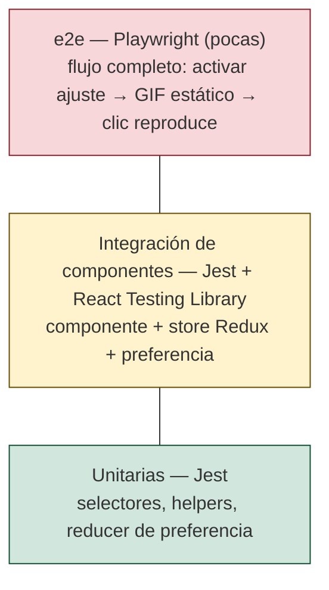

# Estrategia de pruebas

> Entregable 2 — sección (a). Issue del tablero: #13 "Issues, ramificación y estrategia de tests".
> Relacionado: [Flujo de desarrollo](../04-development-process/flujo-desarrollo.md) · [CI](../07-deployment-and-monitoring/ci-github-actions.md) · issue #26 (pruebas Jest/e2e y cobertura)

## 1. Objetivo

Asegurar que el ajuste **"Permitir imágenes y emojis animados"** (#17740) funciona en todos los puntos donde
Mattermost renderiza GIFs y emojis, **sin romper el comportamiento actual** (ajuste activado por defecto), y producir
evidencia medible (cobertura, defectos) para el proceso.

## 2. Pirámide de pruebas



| Nivel | Herramienta | Qué cubre | Dónde viven | Cuándo corren |
|---|---|---|---|---|
| Unitarias | Jest | Selector de la preferencia (`get(state, category, name, default)`), helpers que deciden si animar, valor por defecto `true` | Junto al archivo: `foo.ts` → `foo.test.ts` (convención Mattermost) | Local + cada PR |
| Componentes | Jest + React Testing Library (`renderWithContext`) | Toggle en *Configuración > Pantalla*; `SizeAwareImage`, `SingleImageView`, `MarkdownImage`, `PostEmoji`, `Reaction`, vista ampliada: render estático vs. animado, clic/tap reproduce, botón de pausa, auto-ocultar (timers falsos) | Co-ubicadas en `app/webapp/channels/src/components/...` | Local + cada PR |
| e2e | Playwright (`app/e2e-tests/playwright`, ya trae specs de `accessibility/`) | 2–3 escenarios de punta a punta sobre servidor real | `app/e2e-tests/playwright/specs/functional/...` | Manual antes de Code Freeze (#28) y para la demo |
| Manual / exploratoria | Mattermost local + checklist | Escritorio (hover) vs. móvil (tap), hilos, vista ampliada | Evidencia en el PR (captura/GIF) | Antes de pedir revisión |

**Por qué este reparto.** El 95 % del cambio es frontend React; Mattermost ya tiene una infraestructura Jest/RTL madura
(miles de pruebas, utilidades `renderWithContext`, mocks de store). Escribir ahí la mayoría de pruebas es barato, rápido y
corre en CI en minutos. Las e2e necesitan servidor + base de datos + navegador: son costosas de mantener en CI para un
equipo de 3, por eso se limitan a los escenarios de la demo y se corren manualmente.

## 3. Matriz criterio → prueba

| # | Criterio de aceptación (#17740) | Prueba | Nivel |
|---|---|---|---|
| C1 | Existe el toggle en Configuración > Pantalla, activado por defecto | `user_settings_display.test.tsx` | Componente |
| C2 | Cambiar el toggle guarda la preferencia del usuario (API de preferencias) | `user_settings_display.test.tsx` (mock de `savePreferences`) | Componente |
| C3 | Ajuste activado → GIF se reproduce igual que hoy (regresión) | `size_aware_image.test.tsx`, `single_image_view.test.tsx`, `markdown_image.test.tsx` | Componente |
| C4 | Ajuste desactivado → GIF muestra primer cuadro (estático) | mismos archivos, caso nuevo | Componente |
| C5 | Clic/tap sobre GIF estático lo reproduce; aparece botón de pausa | mismos archivos + `user-event` | Componente |
| C6 | Botón de pausa se oculta tras N s de inactividad | `jest.useFakeTimers()` + `advanceTimersByTime` | Componente |
| C7 | Emojis animados (mensaje y reacciones) estáticos con ajuste desactivado | `post_emoji.test.tsx`, `reaction.test.tsx` | Componente |
| C8 | Vista ampliada respeta estado pausado | `file_preview_modal.test.tsx`, `image_preview.test.tsx` | Componente |
| C9 | Flujo completo usuario: desactivar → ver canal con GIF → estático → clic → anima | spec Playwright nueva | e2e |

La matriz se actualiza cuando los issues #16 y #24 identifican nuevos puntos de renderizado.

## 4. Suite de la mejora (`tests/jest.config.feature.js`)

Configuración Jest propia que **reutiliza la config oficial** del webapp y la acota a los componentes afectados.
Así se obtiene:

- una suite de regresión rápida (segundos/minutos, no los ~80 min de la suite completa), y
- un **porcentaje de cobertura de los módulos afectados**, que es la métrica de cobertura del proyecto.

```bash
cd app/webapp/channels
npx jest --config ../../../tests/jest.config.feature.js --coverage
# reporte: app/webapp/channels/coverage/feature-17740/ (lcov + coverage-summary.json)
```

Para agregar un componente a la suite: añadir su ruta en `FEATURE_PATHS` dentro del archivo.

## 5. Reglas del equipo

1. **Prueba primero el criterio**: cada criterio de aceptación del issue tiene al menos una prueba antes de pedir revisión.
2. **Regresión explícita**: todo componente modificado mantiene un caso con el ajuste **activado** que verifica el
   comportamiento original.
3. **Snapshots** solo como complemento; las aserciones van sobre roles/atributos accesibles (`getByRole`, `alt`,
   `aria-label`), coherente con el objetivo de accesibilidad.
4. **Timers y animación**: usar `jest.useFakeTimers()`; no usar `setTimeout` reales en pruebas.
5. **IA asistiendo pruebas**: se permite generar borradores de pruebas con IA; el autor debe ejecutarlas, verificar que
   fallan sin el cambio (prueba de mutación manual) y registrar el prompt.
6. **CI rojo no se integra**: los jobs `jest`, `lint`, `types` y `build` son obligatorios para merge.

## 6. Métricas que alimenta

| Métrica | Cómo se obtiene | Valor aceptable (propuesto) |
|---|---|---|
| Cobertura de líneas de módulos afectados | Resumen del job `jest` en CI (`coverage-summary.json`, artefacto por ejecución) | Línea base medida antes del primer cambio; meta final **≥ línea base y ≥ 80 % en archivos nuevos** |
| Defectos escapados | Issues `bug` con origen "Después de integrar a main" | ≤ 1 por entrega |
| Defectos en revisión | Comentarios de revisión por PR (plantilla de PR) | Tendencia a la baja entre E2 y final |

**Línea base** (suite de la mejora sobre `main` sin cambios, v11.11.1, ejecución local 2026-11-06):

| Suites | Pruebas | Snapshots | Tiempo | Statements | Branches | Functions | Lines |
|---|---|---|---|---|---|---|---|
| 24 | 197 ✔ | 68 | ~21 s | 71.49 % (1041/1456) | 62.54 % (576/921) | 64.59 % (166/257) | **71.70 % (1034/1442)** |

Confirmar con la primera ejecución en CI y registrar en el documento de métricas (#20, #27).
