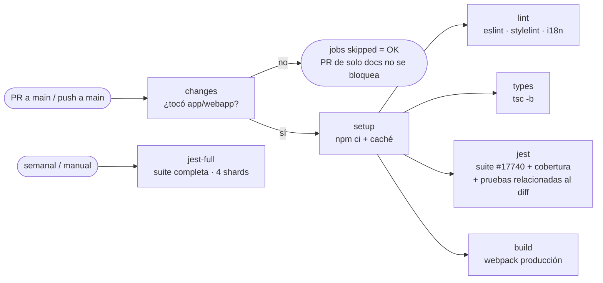

# Integración continua — GitHub Actions

> Entregable 2 — sección (a), práctica "Actions". Issue del tablero: #14 "GitHub Actions: lint, build y Jest".
> Workflow: [`.github/workflows/webapp-ci.yml`](../../.github/workflows/webapp-ci.yml) ·
> Acción reutilizable: [`.github/actions/webapp-setup`](../../.github/actions/webapp-setup/action.yml)

## 1. Por qué un workflow propio

El snapshot de Mattermost en `app/` trae sus propios workflows (`app/.github/workflows/`), pero GitHub **solo ejecuta
los que están en `.github/` de la raíz del repositorio**, y además asumen que el código está en la raíz (`webapp/`),
usan secretos (Codecov) y corren ~10 jobs con shards. Se diseñó un workflow propio, basado en `webapp-ci.yml` oficial,
ajustado a la estructura `app/webapp` y al tamaño del equipo.

## 2. Diseño del pipeline

| Job | Qué hace | Comando | Bloquea merge |
|---|---|---|---|
| `changes` | Detecta si el cambio toca `app/webapp`, `tests/` o el propio CI | `git diff --name-only` | — |
| `setup` | Instala Node 24.11 (`app/.nvmrc`) y dependencias; guarda caché de `node_modules` por hash de `package-lock.json` | `npm ci --include=dev` | — |
| `lint` | ESLint + Stylelint de todos los workspaces; verifica que textos nuevos de UI estén en `en.json` | `npm run check` · `npm run i18n-extract:check` | Sí |
| `types` | Chequeo de tipos TypeScript | `npm run check-types` | Sí |
| `jest` | (1) Suite de la mejora con cobertura ([config](../../tests/jest.config.feature.js)); (2) en PR, pruebas relacionadas con los archivos cambiados (`--changedSince`); (3) tabla de cobertura en el resumen del run + artefacto 90 días | `npx jest ...` | Sí |
| `build` | Compilación de producción del webapp | `npm run build` | Sí |
| `jest-full` | Suite completa de `channels` en 4 shards. Solo lunes 06:00 UTC o manual (*Run workflow* → `full-tests`) | `npm run test-ci -- --shard=n/4` | No |

### Decisiones

- **Pruebas selectivas en PR, completas semanalmente.** La suite completa de Mattermost tarda ~80 min de CPU; correrla
  en cada PR desincentiva integrar seguido (contradice GitHub Flow y empeora *lead time*). En PR corren la suite de la
  mejora + las pruebas que Jest relaciona con el diff; la completa corre semanal para detectar regresiones indirectas.
- **Detección de cambios dentro del workflow** (no filtro `paths:` en el *trigger*): si el workflow no se ejecuta, los
  *checks* requeridos quedan "pendientes" y bloquean PRs de solo documentación. Con jobs *skipped* GitHub los cuenta
  como exitosos.
- **Un job `setup` que calienta la caché** antes de los jobs paralelos evita 4 instalaciones simultáneas en frío.
- **Permisos mínimos** (`contents: read`) y `persist-credentials: false`: el workflow no puede escribir en el repo.
- **`concurrency`**: un push nuevo a un PR cancela la ejecución anterior.
- **Costo**: repositorio público → minutos de Actions gratuitos en *runners* estándar de GitHub.

### Limitaciones conocidas

- No se ejecutan pruebas del servidor Go ni e2e en CI (la mejora no toca backend; e2e manual, ver estrategia de pruebas).
- La primera ejecución sin caché tarda más (instalación completa ~5–8 min).
- La cobertura **no** tiene umbral obligatorio todavía: primero se mide la línea base (#20/#27); cuando exista, se puede
  agregar `coverageThreshold` en `tests/jest.config.feature.js`.

## 3. Uso para el equipo

| Quiero... | Cómo |
|---|---|
| Ver por qué falló el CI de mi PR | PR → pestaña *Checks* → job en rojo → paso fallido |
| Correr lo mismo localmente | `cd app/webapp && npm run check && npm run check-types` · `cd channels && npx jest --config ../../../tests/jest.config.feature.js --coverage` |
| Ver la cobertura de la mejora | Run del workflow → *Summary* (tabla) o artefacto `coverage-feature-17740-<n>` |
| Correr la suite completa | *Actions* → *Webapp CI* → *Run workflow* → marcar `full-tests` |

## 4. Configuración pendiente en GitHub (dueño del repo)

*Settings → Branches → Add rule* para `main` (detalle en [flujo de desarrollo](../04-development-process/flujo-desarrollo.md#protección-de-main-configuración-en-github--settings--branches)):
requerir PR, 1 aprobación, y *status checks* `lint`, `types`, `jest`, `build`.
Los *checks* aparecen en la lista para seleccionar después de la primera ejecución del workflow.

## 5. Evidencia para el entregable

- Captura de la pestaña *Actions* con ejecuciones en verde/rojo.
- Captura de un PR con *checks* requeridos.
- Tabla de cobertura del *Summary* (línea base y final).
